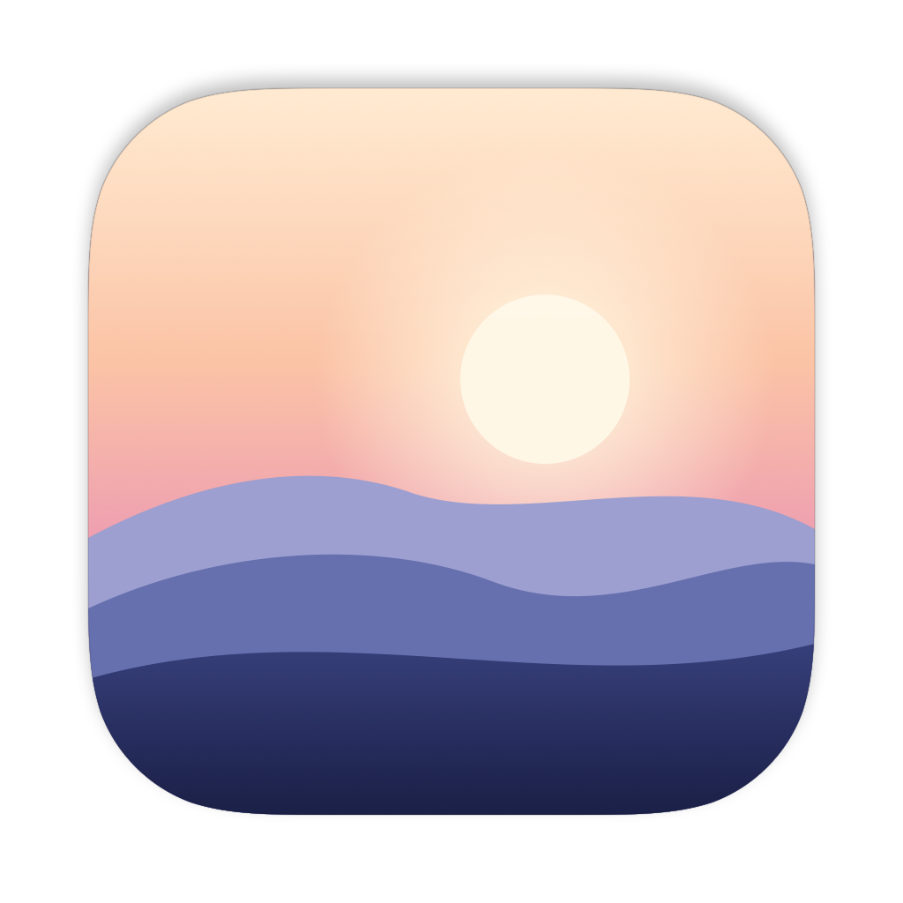
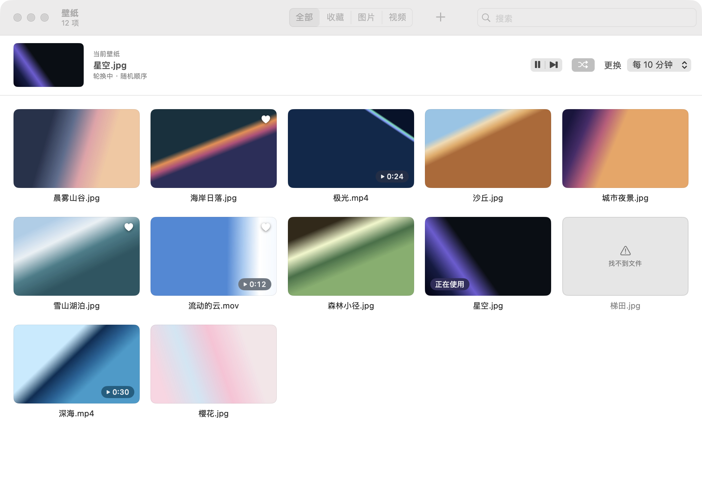
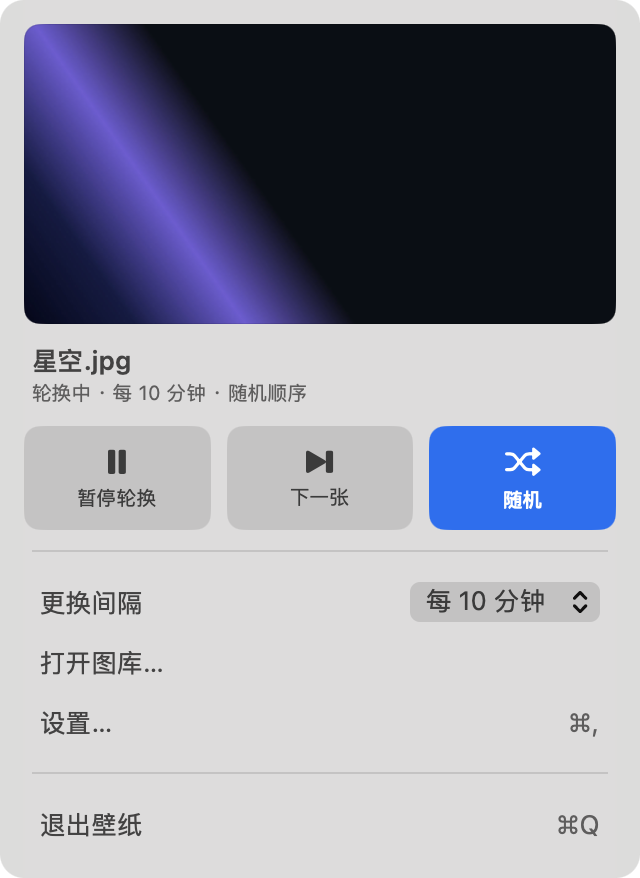
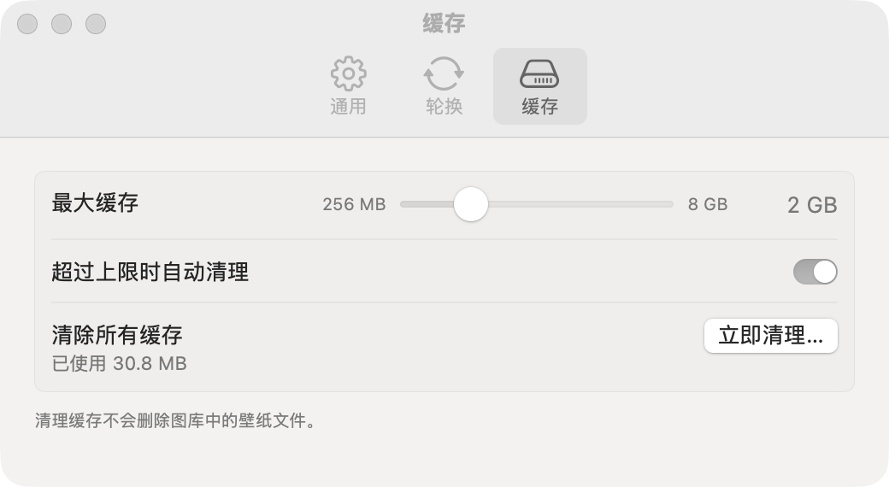

<div align="center">



# 壁纸 · WallpaperApp

一个原生的 macOS 动态壁纸应用：把本地图片和视频铺满桌面，定时轮换，安静地待在菜单栏里。


<picture>
  <source media="(prefers-color-scheme: dark)" srcset="Assets/screenshots/main-dark.png">
  
</picture>

</div>

## 功能

- **图片与视频壁纸**：支持常见图片格式（含 HEIC）和视频，视频静音循环播放。
- **定时轮换**：每 5 / 10 / 30 分钟、每小时或每天自动更换，可随机或按顺序；随时暂停、继续或跳到下一张。
- **图库**：按全部 / 收藏 / 图片 / 视频筛选，按文件名搜索；收藏、在访达中显示、找不到的文件会单独标出。
- **拖放导入**：把图片、视频或整个文件夹拖进窗口即可添加。
- **菜单栏面板**：不打开主窗口也能看到当前壁纸、暂停轮换、切换下一张或调整间隔。关闭主窗口后壁纸继续在后台轮换。
- **多显示器、多桌面空间**：每块屏幕都会铺上壁纸，接入或拔出显示器自动适配。
- **网络卷视频缓存**：位于网络卷上的视频会缓存到本地，可设置缓存上限并自动清理。
- **原生体验**：全部使用系统控件和语义色，深色/浅色自动适配；动画遵循“减弱动态效果”设置。

<table>
  <tr>
    <td align="center" width="40%">
      <picture>
        <source media="(prefers-color-scheme: dark)" srcset="Assets/screenshots/menubar-dark.png">
        
      </picture>
      <br><sub>菜单栏面板</sub>
    </td>
    <td align="center" width="60%">
      <picture>
        <source media="(prefers-color-scheme: dark)" srcset="Assets/screenshots/settings-dark.png">
        
      </picture>
      <br><sub>设置（通用 / 轮换 / 缓存）</sub>
    </td>
  </tr>
</table>

## 使用

1. 点击工具栏的 **＋**（或 ⌘O），选择图片、视频或文件夹；也可以直接拖进窗口。
2. 单击选中，**双击或回车**设为壁纸。手动指定后轮换会暂停，点“继续轮换”恢复。
3. 右键可以收藏、在访达中显示或从图库移除；选中后按 **Delete** 也能移除（不会删除文件）。
4. 在顶部的“当前壁纸”条或菜单栏面板里调整更换间隔和随机顺序。

### 快捷键

| 操作 | 快捷键 |
| --- | --- |
| 添加壁纸 | ⌘O |
| 下一张 | ⌘N |
| 设为壁纸（选中时） | 回车 |
| 从图库移除（选中时） | Delete |
| 设置 | ⌘, |

## 构建与运行

需要 macOS 14 及以上，Xcode 15+ 或 Swift 5.9+ 工具链。

```bash
swift run --disable-sandbox
```

也可以用 Xcode 打开 `Package.swift`，选择 `WallpaperApp` 目标后运行。

### 打包成 .app

```bash
scripts/package.sh
open WallpaperApp.app
```

脚本会编译 release 版本，生成带图标和中文本地化的 `WallpaperApp.app`，并做 ad-hoc 签名。可以用环境变量调整：

| 变量 | 说明 | 默认值 |
| --- | --- | --- |
| `CONFIG` | `release` 或 `debug` | `release` |
| `VERSION` | 版本号 | 最近的 git tag，否则 `0.2.0` |
| `SIGN_IDENTITY` | 签名身份，例如 `Developer ID Application: …` | `-`（ad-hoc） |

<details>
<summary>受限环境下构建（缓存目录不可写时）</summary>

```bash
export TMPDIR=/tmp
export CLANG_MODULE_CACHE_PATH=/tmp/clang-module-cache
export SWIFTPM_CACHE_PATH=/tmp/swiftpm-cache
swift build --disable-sandbox
```

</details>

### 登录时打开

“登录时打开”使用 `SMAppService.mainApp`，需要以打包后的 `.app` 运行，并且最好用开发者证书签名（`SIGN_IDENTITY=… scripts/package.sh`）。直接 `swift run` 时这个开关无法打开。

## 项目结构

```
Sources/WallpaperApp/
├── WallpaperApp.swift        # App 入口：主窗口、设置、菜单栏
├── ContentView.swift         # 图库主窗口：当前壁纸条、网格、空状态
├── MenuBarPanel.swift        # 菜单栏面板
├── SettingsView.swift        # 设置窗口（通用 / 轮换 / 缓存）
├── AppCommands.swift         # 菜单命令
├── WallpaperManager.swift    # 壁纸轮换、暂停、多屏窗口
├── WallpaperWindowController.swift / WallpaperView.swift  # 桌面层窗口与图片/视频渲染
├── LibraryActions.swift      # 导入、移除、收藏等图库操作
├── ThumbnailProvider.swift   # 异步缩略图与视频时长
├── CacheManager.swift        # 网络卷视频缓存
├── SettingsStore.swift       # 设置持久化
└── Motion.swift              # 动画参数
scripts/
├── package.sh                # 打包 .app
└── make_icon.swift           # 生成 App 图标
```

App 图标由代码绘制，修改后运行 `swift scripts/make_icon.swift` 重新生成 `Assets/AppIcon.icns`。
